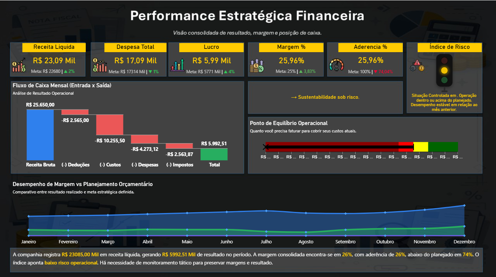

# Gestão Financeira

## 1. Apresentação

Demonstração web de resultado, margem, orçamento, aderência e ponto de equilíbrio, com uma base financeira inteiramente fictícia criada por autorização do autor.

## 2. Problema de negócio

Relacionar receitas, gastos e orçamento para explicar resultado e necessidade de cobertura dos custos.

## 3. Objetivo

Disponibilizar uma experiência demonstrativa no navegador e material técnico reproduzível, preservando os relatórios existentes.

## 4. Funcionalidades

Filtros por ano, mês e centro; receita líquida, despesas, lucro, margem e aderência; cascata de resultado; comparação de equilíbrio; evolução mensal; semáforo de risco; download das duas bases CSV.

## 5. Tecnologias

HTML, CSS, JavaScript ES modules e SVG. Node.js 22 ou superior somente para testes. Python 3 somente para servidor local e scripts de preparação. A interface não instala bibliotecas, não exige login e não consulta serviços de negócio.

## 6. Arquitetura

Dados locais → seleção no navegador → cálculos JavaScript → apresentação HTML/SVG. [Detalhes](docs/ARQUITETURA.md).

## 7. Estrutura

```text
dados/             Bases CSV sintéticas
generate_data.py   Geração determinística
web/               HTML, CSS, JavaScript e snapshot JSON
tests/             Reconciliação financeira em Node
docs/              Metodologia e captura de referência
```

## 8. Instalação

Clone este repositório. Para abrir a aplicação use um servidor HTTP local; abrir o HTML diretamente por file:// impede o carregamento do JSON em alguns navegadores. Não é necessário `npm install`.

## 9. Configuração

Sem `.env`, senha, chave ou conta Power BI para usar a versão web. Todos os arquivos necessários estão em `web/`.

## 10. Execução

```sh
python -m http.server 8000 --directory web
```

Abra http://localhost:8000. Na web publicada: [abrir dashboard](https://leandroaugferreira.github.io/dashboards/financeiro/).

## 11. Testes

```sh
node --test tests/*.test.mjs
```

Os testes verificam identidades de negócio e integridade. [Validação](docs/VALIDACAO.md). O workflow usa permissões de leitura e não executa integrações de negócio.

## 12. Evidências reais

A imagem abaixo é a captura original do Power BI já apresentada no portfólio; não é uma captura da versão web. [Navegar pela versão web](https://leandroaugferreira.github.io/dashboards/financeiro/).



## 13. Limitações

O PBIX correspondente à versão financeira atualmente publicada não foi localizado. Portanto, os cálculos desta demonstração são definidos em docs/METODOLOGIA.md e não são atribuídos ao DAX daquele relatório. A versão web usa dados sintéticos e pode apresentar números e risco diferentes da captura Power BI.

## 14. Estado e dados

Os dados desta versão são SINTÉTICOS, gerados de forma determinística por generate_data.py em 03/11/2026. Não são uma extração do relatório Power BI publicado. A captura existente serve apenas de referência de apresentação e raciocínio financeiro. O relatório original continua preservado no portfólio.

360 movimentações sintéticas, 72 registros de orçamento, 2025–2026 e três centros: Comercial, Serviços e Operações. Valores de origem em centavos inteiros; nenhuma pessoa ou empresa real.

Execute `python generate_data.py`; copie os CSV de `dados/` para `web/dados/` se regenerar os arquivos distribuídos para download. O gerador escreve apenas a base desta demonstração.

A publicação foi autorizada pelo autor. Não foi atribuída uma nova licença ao código ou às bases. Materiais didáticos de terceiros mantêm sua origem e não são apresentados como uma implantação empresarial do autor.

## 15. Portfólio

[Página do projeto](https://leandroaugferreira.github.io/financeiro.html) · [Perfil GitHub](https://github.com/LeandroAugFerreira)
