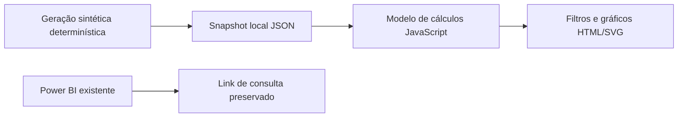

# Arquitetura — Gestão Financeira

Todo o processamento da versão web acontece no navegador. Não há backend, emissão de documentos, e-mail, telemetria ou transferência da base para APIs de terceiros. Arquivos geográficos locais são recursos cartográficos, não acrescentam nem alteram registros de negócio.

Os dados desta versão são SINTÉTICOS, gerados de forma determinística por generate_data.py em 03/11/2026. Não são uma extração do relatório Power BI publicado. A captura existente serve apenas de referência de apresentação e raciocínio financeiro. O relatório original continua preservado no portfólio.
